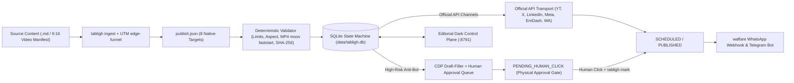

# tabligh-os

**Agentic Omnichannel Content Distribution, Repurposing & Human-Governed Publishing OS**  
Operasionalisasi **Pilar 4 *Tabligh — Bi qadri 'uqulihim***: menyampaikan satu tesis inti dengan adaptasi native sesuai karakteristik audiens tiap kanal di ekosistem Indonesia & Global.

[](https://github.com/ridloabelian/tabligh-os/actions/workflows/ci.yml)


---

## Mengapa `tabligh-os`?

Terinspirasi dari pola terbaik `CzzzzzzJ/mdldm-maitian` dan dirancang ulang dari *First Principles*:

1. **Lintas OS (Linux `systemd` & macOS `launchd`)** — berjalan di Node.js >= 22 + TypeScript + Hono + `node:sqlite`, tanpa ketergantungan macOS.
2. **8 Kanal Global & Indonesia-First** — YouTube (`long` & `shorts`), Instagram (`reels` & `carousel`), TikTok (`video` & `photo_carousel`), X (`tweet`, `thread`, `article`), LinkedIn, Threads, WhatsApp Channel, serta CMS EmDash (`ridlo.id`).
3. **Hybrid Dual-Transport + Physical Approval Gate** — API resmi dijadwalkan/dipublikasikan otomatis setelah lulus validator deterministik, sementara platform anti-bot ketat (TikTok Web & IG Trending Audio) wajib berhenti di **`PENDING_HUMAN_CLICK`** dengan staging paket + CDP Draft-Filler (tanpa pernah menyimpan password).
4. **Atribusi `edge-funnel` Otomatis** — setiap URL keluar pada `publish.json` disuntik parameter `?utm_source=<platform>&utm_medium=social&utm_campaign=<episode_id>&ef_ep=<episode_id>`.
5. **Notifikasi Interaktif Indonesia-First** — status kartu rilis terkirim ke **WhatsApp (`waflare` webhook)** & **Telegram Bot API**.

---

## Arsitektur Sistem



---

## Quickstart 5 Detik (`npm run demo`)

Lihat seluruh Control Plane, Human Approval Queue ("Siap Klik Publish"), Matriks 8 Kanal, dan Healthcheck **tanpa kredensial API apa pun**:

```bash
git clone https://github.com/ridloabelian/tabligh-os.git
cd tabligh-os
npm install
npm run demo
```

Buka browser ke **[http://localhost:8791](http://localhost:8791)**.

---

## Alur CLI Lengkap (`tabligh`)

```bash
# 1. Ingest esai Markdown (ridlo.id frontmatter) atau manifest video 9:16
npm run tabligh -- ingest examples/wakaf-produktif.md --out publish.json

# 2. Validasi deterministik (batas karakter, aspect ratio, MP4 moov faststart, anti-dobel SHA-256)
npm run tabligh -- validate publish.json

# 3. Simpan paket tervalidasi ke SQLite state store
npm run tabligh -- plan publish.json

# 4. Jalankan state machine (simulasi --dry-run atau live, filter --only x,linkedin)
npm run tabligh -- run publish.json --dry-run
npm run tabligh -- run publish.json --only x,linkedin,emdash

# 5. Konfirmasi manual setelah operator klik Publish di TikTok / IG Trending Audio
npm run tabligh -- mark ep-wakaf-produktif-cashflow-riil tiktok PUBLISHED --url "https://www.tiktok.com/@ridloabelian/video/123"

# 6. Periksa kesiapan token API, waflare/Telegram webhook, dan Chrome CDP
npm run tabligh -- doctor

# 7. Jalankan server Control Plane di port default :8791
npm run tabligh -- serve --port 8791
```

---

## Matriks Transport: Official API vs Physical Approval Gate

| Kanal | Subformat | Batas Utama | Transport Default | Status Terminal Runner |
| :--- | :--- | :--- | :--- | :--- |
| **YouTube** | `long`, `shorts` | Judul `<= 100`, Desk `<= 5000`, `shorts` `9:16 <= 180s` | `official_api` | `SCHEDULED` / `PUBLISHED` |
| **X** | `tweet`, `thread`, `article` | Tweet/Item `<= 280`, Article `<= 25000` | `official_api` | `PUBLISHED` |
| **LinkedIn** | `post`, `article` | Body `<= 3000` | `official_api` | `SCHEDULED` / `PUBLISHED` |
| **Instagram** | `reels`, `carousel` | Caption `<= 2200`, Hashtag `<= 30` | `official_api` (`cdp_draft` jika `useTrendingAudio`) | `PUBLISHED` / `PENDING_HUMAN_CLICK` |
| **TikTok** | `video`, `photo_carousel` | Caption `<= 2200`, Media `9:16` faststart | **`cdp_draft`** | **`PENDING_HUMAN_CLICK`** |
| **Threads** | `post`, `thread` | Post/Item `<= 500` | `official_api` | `PUBLISHED` |
| **WhatsApp Channel** | `broadcast` | Body `<= 4096` | `official_api` (`waflare`) | `PUBLISHED` |
| **EmDash CMS** | `posts`, `notes` | Title `<= 160`, `slug` kebab-case, Body `>= 50` | `official_api` | `PUBLISHED` |

---

## Integrasi `edge-funnel`, `waflare` & Telegram

### Atribusi `edge-funnel`
Semua URL di `ctaUrl`, `body`, dan `threadItems` otomatis disuntik query parameter standar oleh [`src/core/utm.ts`](src/core/utm.ts) secara idempoten (aman dipanggil berulang tanpa duplikasi key):

```text
https://ridlo.id/posts/wakaf-produktif?utm_source=x&utm_medium=social&utm_campaign=ep-2026-wakaf-produktif&ef_ep=ep-2026-wakaf-produktif
```

### Webhook WhatsApp (`waflare`) & Telegram
Setiap siklus `run` mengirim kartu status ke:
- **`WAFLARE_WEBHOOK_URL`**: Payload JSON `{ event: "tabligh.release_status", episodeId, to, text, approvalQueueCount, dashboardUrl, jobs }`
- **Telegram Bot API**: `POST https://api.telegram.org/bot<TELEGRAM_BOT_TOKEN>/sendMessage` dengan format HTML ringkas + tombol inline ke Control Plane `http://localhost:8791`.

---

## Deployment Lintas OS (`systemd` & `launchd`)

- **Linux (`systemd --user`)**: Template tersedia di [`deploy/systemd/tabligh-os.service`](deploy/systemd/tabligh-os.service), [`deploy/systemd/tabligh-os-runner.service`](deploy/systemd/tabligh-os-runner.service), dan [`deploy/systemd/tabligh-os-runner.timer`](deploy/systemd/tabligh-os-runner.timer).
- **macOS (`launchd`)**: Template tersedia di [`deploy/launchd/id.ridlo.tabligh-os.plist`](deploy/launchd/id.ridlo.tabligh-os.plist).

---

## Agent Skill

Agent coding (`Claude Code`, `saif-agent`, `OpenCode`, `Antigravity`) dapat membaca panduan repurposing native di [`skills/tabligh-repurpose/SKILL.md`](skills/tabligh-repurpose/SKILL.md).

---

## Pengujian & Verifikasi

```bash
npm run typecheck
npm run build
npm test
```

## Lisensi

[MIT](LICENSE) — Copyright (c) 2026 Ridlo Abelian.
